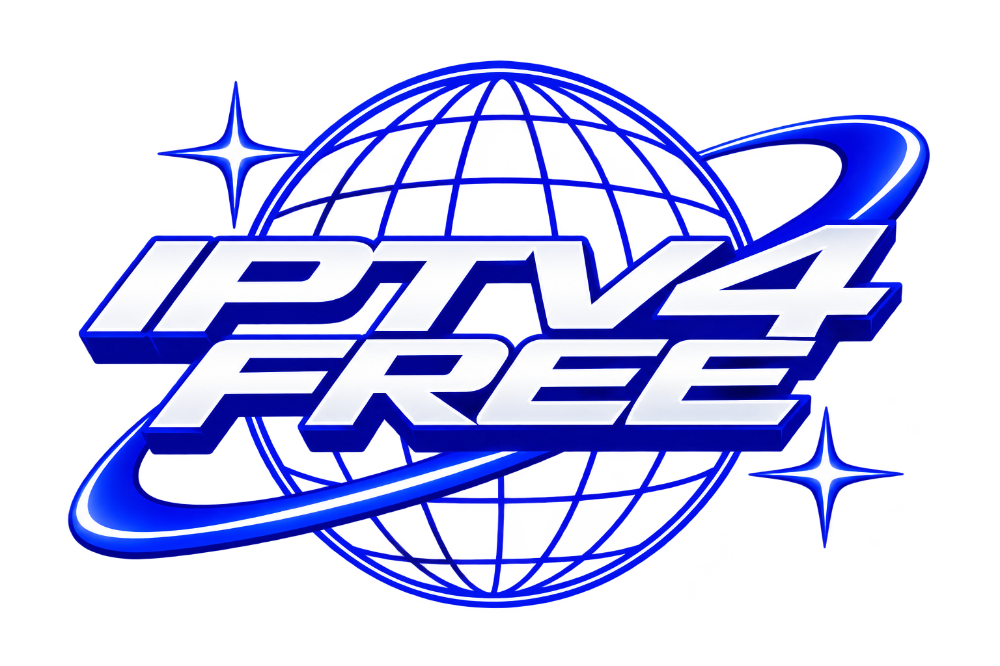
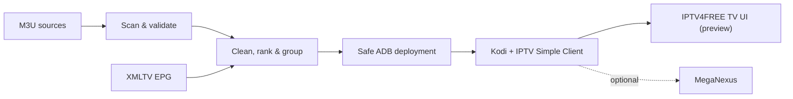

<div align="center">
  
  <h1>IPTV4FREE</h1>
  <p><strong>YOUR CHANNELS. YOUR SCREEN. YOUR CONTROL.</strong></p>
  <p>A clean, open-source IPTV workflow for <strong>Kodi</strong> and <strong>Android TV</strong>.<br />
  Validate streams, curate channels, deploy safely, and enjoy a dedicated TV interface.</p>

  <p>
    <a href="https://github.com/searadacunha/IPTV4FREE/actions/workflows/tests.yml"></a>
    
    
    
    <a href="LICENSE"></a>
  </p>

  <p>
    <a href="#the-tv-experience">See the interface</a> ·
    <a href="#install-the-tv-interface">Get the app</a> ·
    <a href="#quick-start">Quick start</a> ·
    <a href="docs/TECHNICAL-GUIDE.md">Technical documentation</a>
  </p>
</div>

---

## The TV experience

<p align="center">A dedicated IPTV4FREE interface for the channels already configured in Kodi — designed for the remote, not the mouse.</p>

<table>
  <tr>
    <td width="60%"></td>
    <td width="40%"></td>
  </tr>
  <tr>
    <td><sub>LIVE TV · Channel browsing and programme information</sub></td>
    <td><sub>NOW & NEXT · Programme details</sub></td>
  </tr>
</table>

<sub>Real screenshots from Kodi 21.3 on macOS using fictional test channels. This branch contains the interface and launcher shown here. Both are tracked in <a href="https://github.com/searadacunha/IPTV4FREE/pull/3">PR #3</a> before release to main.</sub>

## Built around what matters

| **For the TV** | **Behind the scenes** |
| :--- | :--- |
| **Live channels, without the clutter** — A dedicated Kodi screen, country/category groups, channel logos and remote navigation. | **Stream validation** — Concurrent HLS, DASH and direct-stream probing, with failure history. |
| **Now, next, and EPG** — Programme data, guide access, search and personal favourites. | **Clean lineups** — Deduplication, stable channel numbers, priority ordering and EPG mapping. |
| **Your own Android TV tile** — An optional shortcut launches the IPTV4FREE interface through Kodi. | **Safe deployment** — ADB checks, dry runs, checksums, backups, shrink protection and rollback. |

**No separate IPTV player.** Kodi and IPTV Simple Client remain the playback engine. IPTV4FREE supplies the organization layer and, in the development branch, its own branded interface. MegaNexus remains an optional, separate third-party interface.

## Install the TV interface

The following packages are built and tracked in [PR #3](https://github.com/searadacunha/IPTV4FREE/pull/3). They are **preview builds**, not yet merged into `main`.

| Package | What it does | Download |
| :--- | :--- | :--- |
| **IPTV4FREE Kodi add-on 0.3.1** | Branded live TV interface inside an existing Kodi installation. | [Download ZIP](https://github.com/searadacunha/IPTV4FREE/raw/refs/heads/feat/iptv4free-tv-ui/dist/script.iptv4free-0.3.1.zip) |
| **IPTV4FREE Android TV launcher 0.1.2** | Adds an IPTV4FREE tile to the Android TV home screen and launches the Kodi add-on. | [Download APK](https://github.com/searadacunha/IPTV4FREE/raw/refs/heads/feat/iptv4free-tv-ui/dist/IPTV4FREE-AndroidTV-Launcher-0.1.2.apk) |

The Kodi ZIP is served locally for installation using the included range-aware server (`python3 scripts/serve_addon.py` from the development branch). **Do not use the standard Python HTTP server** for this Kodi version. For precise installation, requirements, testing evidence and rollback, see the [Kodi interface guide](docs/IPTV4FREE-TV-UI.md) and [Android launcher guide](docs/IPTV4FREE-ANDROID-TV-LAUNCHER.md).

## Quick start

Run the playlist-management toolkit on macOS or Linux. The computer and Android TV must be reachable on the same network via ADB.

```bash
git clone https://github.com/searadacunha/IPTV4FREE.git
cd IPTV4FREE
python3 -m venv .venv
source .venv/bin/activate
pip install -e .

cp config/example.toml iptv4free.toml
# Set [tv].address to your Android TV's authorized ADB address.

iptv4free setup
iptv4free scan
iptv4free build
iptv4free deploy --dry-run
iptv4free deploy --allow-large-update  # For the reviewed initial import only
iptv4free doctor
```

Later updates use `iptv4free update`. Large changes are refused unless explicitly approved. The TV reads its deployed playlists locally; your computer is only needed when refreshing them.

## How it works



| Step | What IPTV4FREE guarantees |
| :--- | :--- |
| **Scan** | Timeouts, per-source snapshots, and consecutive-failure tracking instead of dropping channels after one bad request. |
| **Build** | Deterministic M3U output, cleaned names, highest-quality duplicates, stable numbers and EPG identifiers. |
| **Deploy** | Change-count limits, lineup shrink protection, atomic upload, SHA-256 verification, backups and a playback-aware restart policy. |
| **Diagnose** | `iptv4free doctor` checks the pipeline, device, Kodi and deployed files without making changes. |

## Documentation

- [Technical reference](docs/TECHNICAL-GUIDE.md) — configuration, deployment, channel management, architecture, benchmarks, troubleshooting and limitations.
- [Example configuration](config/example.toml) — M3U sources, countries, favourites, EPG and safety limits.
- [TV interface & install guide](docs/IPTV4FREE-TV-UI.md) — Kodi interface, remote navigation and validation on the test TV.
- [Android TV launcher guide](docs/IPTV4FREE-ANDROID-TV-LAUNCHER.md) — APK installation, shortcut behaviour and security.
- [Contributing](CONTRIBUTING.md) · [Security](SECURITY.md) · [Third-party notices](THIRD_PARTY_NOTICES.md)

## Verified scope

The playlist automation pipeline has automated tests and documented measurements in the [technical reference](docs/TECHNICAL-GUIDE.md). The optional Kodi UI has also been evaluated on Kodi 21.3 and a resource-constrained Android TV; see [PR #3](https://github.com/searadacunha/IPTV4FREE/pull/3) for the exact test setup and open issues. Stream availability, guide coverage and device compatibility vary by provider and hardware.

---

<p align="center">
  <strong>IPTV4FREE</strong><br />
  Built for Kodi · Designed for Android TV · Licensed under <a href="LICENSE">MIT</a><br />
  <sub>IPTV4FREE does not host or provide TV streams. Configure sources you are authorized to access.</sub>
</p>
