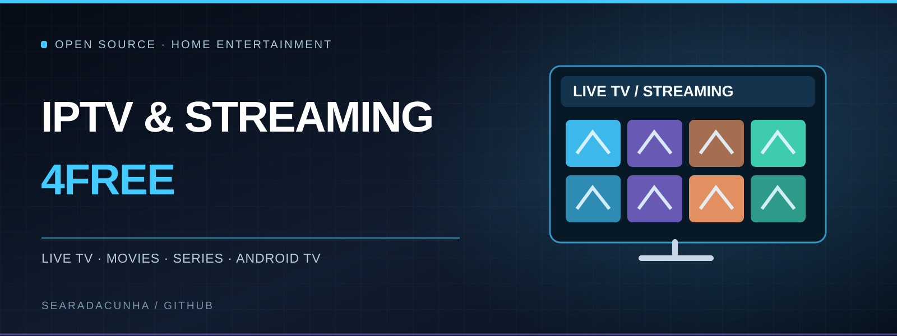
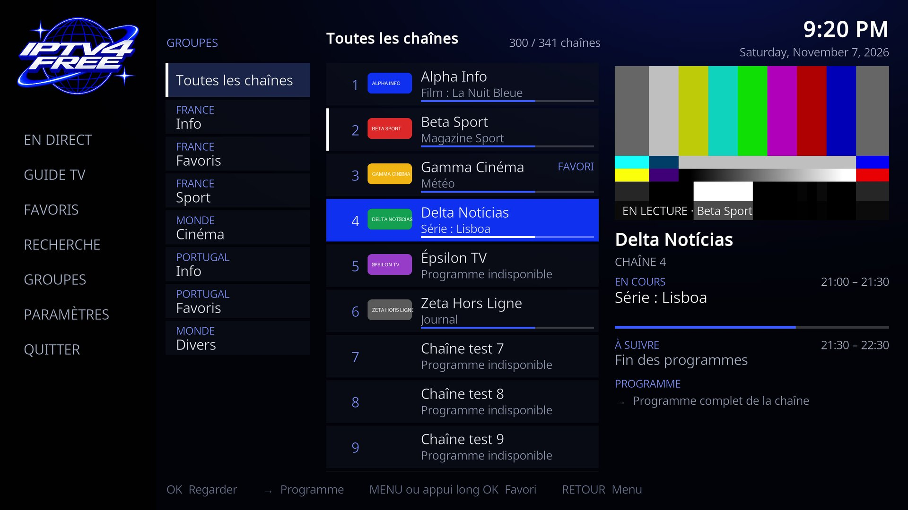
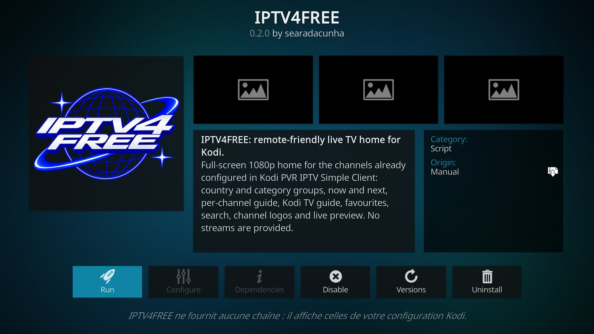
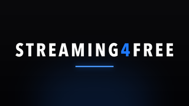
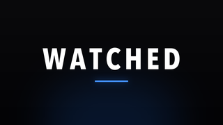
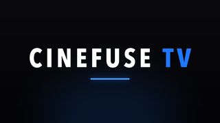

<div align="center">


# IPTVnSTREAMING4FREE

<p align="center"></p>

**YOUR CHANNELS. YOUR SCREEN. YOUR CONTROL.**

**A remote-first IPTV experience for Kodi and Android TV — with a complementary native streaming hub.**

Manage live-TV sources, browse channels through a dedicated TV interface, and launch your viewing apps from the Android TV home screen. One open-source repository, with **IPTV4FREE at its core**.

<p>
  
  
  
  
</p>

**[Explore IPTV4FREE](#iptv4free--live-tv-designed-for-the-remote)** ·
**[Install IPTV4FREE](#get-iptv4free-on-your-tv)** ·
**[STREAMING4FREE](#streaming4free--your-android-tv-hub)** ·
**[Build & install](#build-and-install)** ·
**[Technical details](#architecture-and-project-structure)**

</div>

---

## IPTV4FREE — Live TV, designed for the remote

**A dedicated interface for your own TV lineup.** IPTV4FREE puts live channels, country and category groups, the programme guide, favourites and search into a clean, remote-controlled Kodi experience. Behind that interface, a Python toolkit helps validate, organise and deploy IPTV playlists with repeatable safeguards.

<table>
  <tr>
    <td width="62%"></td>
    <td width="38%"></td>
  </tr>
  <tr>
    <td><sub><strong>LIVE TV</strong> — channel browsing, groups, logos and programme context.</sub></td>
    <td><sub><strong>TV GUIDE</strong> — programme details and navigation.</sub></td>
  </tr>
</table>

<sub>Actual screenshots from Kodi 21.3 using fictional test channels. The TV interface and Android launcher are preserved here as preview builds; Kodi and PVR IPTV Simple Client provide playback.</sub>

### What makes IPTV4FREE different

| TV experience | Playlist-management engine |
|---|---|
| **Purpose-built for a television** — Full-screen interface with remote navigation, live channel preview and a dedicated Android TV shortcut. | **Source checks** — Probe playlist sources and monitor failures instead of trusting every entry blindly. |
| **Channels, without the clutter** — Browse by country and category with channel numbers, logos, search and favourites. | **Clean, stable lineups** — Deduplicate, order and group channels while preserving identifiers and predictable numbering. |
| **Know what's on** — Now/next programme information, EPG access and programme details when available. | **EPG mapping** — Align channel IDs with guide data to improve listings. |
| **Keep Kodi as the playback engine** — IPTV4FREE works with Kodi PVR and an existing IPTV Simple Client configuration. | **Controlled deployment** — Dry runs, integrity checks, backups, update limits and rollback-aware operations over authorised ADB access. |

**Measured on the test setup:** the Kodi interface was exercised on a TCL Android 12 TV with a lineup of 7,883 channels. Recorded opening time was **1.5–1.8 seconds** once Kodi/PVR was running, with **32–72 ms** navigation responses. These are setup-specific measurements, not universal performance guarantees. See the [TV interface test report](iptv-tv-preview/docs/IPTV4FREE-TV-UI.md).

### Get IPTV4FREE on your TV

| Package | What you get | File |
|---|---|---|
| **Kodi add-on · v0.3.1** | The IPTV4FREE interface inside Kodi, navigated with the remote. | **[Kodi ZIP](iptv-tv-preview/dist/script.iptv4free-0.3.1.zip)** |
| **Android TV launcher · v0.2.0** | A branded **IPTV4FREE** tile on the TV home screen that opens the Kodi add-on. | **[Android TV APK](iptv-tv-preview/dist/IPTV4FREE-AndroidTV-Launcher-0.2.0.apk)** |
| **Python toolkit** | Playlist scanning, normalisation, EPG mapping and safe deployment. | **[Source & configuration](iptv/)** |

**Setup:** install Kodi and configure **PVR IPTV Simple Client** with your authorised sources; install the IPTV4FREE Kodi add-on; optionally install the Android TV launcher for direct access from the TV home screen. The launcher depends on Kodi and the add-on — it is **not** an independent IPTV player. Its setup involves local Kodi JSON-RPC and a one-time Android display-over-other-apps permission.

See the **[Kodi interface & installation guide](iptv-tv-preview/docs/IPTV4FREE-TV-UI.md)** and **[Android TV launcher guide](iptv-tv-preview/docs/IPTV4FREE-ANDROID-TV-LAUNCHER.md)** for exact installation, permissions and troubleshooting. These packages are **preview builds**, preserved alongside the stable playlist toolkit rather than represented as one fully integrated release.

### Build your own channel lineup

Run the playlist-management CLI on your computer. Configure your own sources before scanning or deploying.

```bash
git clone https://github.com/searadacunha/STREAMING4FREE-TV.git
cd STREAMING4FREE-TV/iptv

python3 -m venv .venv
source .venv/bin/activate
python -m pip install -e .

cp config/example.toml iptv4free.toml
# Edit iptv4free.toml with your permitted sources and TV settings.

iptv4free setup
iptv4free scan
iptv4free build
iptv4free deploy --dry-run
iptv4free doctor
```

Review the dry-run output before a real deployment. The toolkit supports safeguards for unexpectedly large changes, backups and repeatable updates. Full configuration and command reference: **[IPTV4FREE technical guide](iptv/docs/TECHNICAL-GUIDE.md)**.

---

## STREAMING4FREE — Your Android TV hub

**One TV-focused collection of apps alongside IPTV4FREE.** STREAMING4FREE combines a native browsing and playback hub with two standalone fullscreen website launchers. Each can be built and installed independently.

<div align="center">
  
  
  
</div>

### Three ways to watch

| App | Experience | Source |
|---|---|---|
| **STREAMING4FREE hub** | Native Leanback interface for Live TV, Movies, Series, Sport, Documentaries, YouTube, IPTV, favourites, search and continue-watching. | [`hub/`](hub/) |
| **WATCHED** | Lightweight Android TV fullscreen WebView launcher for watched.cx, with remote playback-key support where available. | [Root launcher](./) |
| **CINEFUSE TV** | Fullscreen cinefuse.cc launcher with remote-friendly navigation, an optional cursor and restricted external-site navigation. | [`cinefuse/`](cinefuse/) |

**Inside the hub:** a public-channel catalogue, country/category playlist browsing, unified search, favourites and on-device history. Its Media3 player supports HLS, DASH, MPEG-TS and MP4, audio/subtitle selection, adaptive quality and reconnect-on-error behaviour. The catalogue's documented Portugal-network test snapshot contained **781 checked free channels**; stream availability changes and is not guaranteed. See [source-testing results](docs/SOURCES.md).

The hub also links to official free services such as ARTE, RTP Play, Plex, Rakuten TV and others, opening installed apps or their store listings where appropriate. Some services are restricted by country or require their own apps.

## Build and install

### Prerequisites

For the Android TV apps: **JDK 17**, Android SDK platform/API 36, Build Tools 36.0.0 and ADB. The hub uses its Gradle wrapper; the two WebView launchers use command-line build scripts. On macOS:

```bash
brew install --cask android-commandlinetools
brew install openjdk@17 android-platform-tools
sdkmanager "build-tools;36.0.0" "platforms;android-36"
```

### Build the streaming apps

From the repository root:

```bash
./build.sh                               # WATCHED
(cd cinefuse && ./build.sh)             # CINEFUSE TV
(cd hub && ./gradlew testDebugUnitTest assembleRelease)  # STREAMING4FREE hub
```

Expected output paths:

- WATCHED: `build/watched-1.0.apk`
- CINEFUSE TV: `cinefuse/build/cinefuse-tv-1.0.apk`
- Hub: `hub/build/outputs/apk/release/streaming4free-hub-release.apk`

### Install over Wi-Fi

Enable authorised ADB debugging on your Android TV, then connect from a computer on the same network. Replace `TV_IP` with the device address.

```bash
adb connect TV_IP:5555
adb -s TV_IP:5555 install -r build/watched-1.0.apk
adb -s TV_IP:5555 install -r cinefuse/build/cinefuse-tv-1.0.apk
adb -s TV_IP:5555 install -r hub/build/outputs/apk/release/streaming4free-hub-release.apk
```

Some TVs require wireless-debugging pairing or a different port. For an automated streaming-app build/install workflow, see `tools/tv.sh install TV_IP` and `tools/tv.sh status TV_IP`.

The IPTV Kodi ZIP and launcher APK use their **own installation procedure** described above. To check and build both project families from the consolidated repository:

```bash
python3 -m pip install -e "./iptv[dev]" pillow
bash tools/build-all.sh check
bash tools/build-all.sh build
```

The consolidated build has additional prerequisites (including Gradle 8.9 and Android SDK API 35); consult the relevant build scripts and guides. A locally rebuilt Android launcher may use a **different signing certificate** from the distributed APK and therefore may not update it in place.

## Remote-first controls

| Where | Action | Result |
|---|---|---|
| **IPTV4FREE / Kodi** | Arrows and OK | Browse groups and channels; open the selected channel. |
| **IPTV4FREE / Kodi** | MENU or long OK (where supported) | Channel actions, favourites and programme access. |
| **IPTV4FREE / Kodi** | Back | Return from a programme to the lineup or from the lineup to Kodi/TV. |
| **STREAMING4FREE hub** | Long OK | Add/remove the selected item from favourites. |
| **STREAMING4FREE hub** | OK during playback | Show quality, seeking, audio and subtitle controls. |
| **WATCHED / CINEFUSE TV** | Back; Play/Pause | Navigate the WebView or control supported HTML5 playback. |
| **CINEFUSE TV** | Long OK | Toggle the pointer for elements that arrows cannot reach. |

For embedded videos inside third-party iframes, WebView media keys may not work; actual controls depend on the website.

## Architecture and project structure

```text
IPTVnSTREAMING4FREE/
├── iptv/                    # Stable Python IPTV toolkit, configuration and tests
├── iptv-tv-preview/         # Kodi TV UI, branding, screenshots and Android TV launcher
│   ├── kodi-addon/          # IPTV4FREE Kodi interface
│   ├── dist/                # Preserved preview ZIP and APK
│   └── docs/                # Installation, screenshots and test evidence
├── hub/                     # STREAMING4FREE native Android TV app (Kotlin / Media3)
├── cinefuse/                # CINEFUSE TV WebView launcher
├── src/ and res/            # WATCHED Android TV launcher
├── tools/                   # Stream probes, TV deployment and consolidated builds
├── docs/SOURCES.md          # Public-stream probe results
├── THIRD_PARTY_NOTICES.md
└── LICENSE
```

**IPTV path:** M3U/XMLTV sources → Python validation and lineup generation → authorised ADB deployment → Kodi + PVR IPTV Simple Client → IPTV4FREE interface (and optional Android TV shortcut).

**Streaming path:** Public-channel catalogues / official apps → native hub with Media3 playback; WATCHED and CINEFUSE remain separate WebView launchers. **One repository does not mean one combined APK.**

## Compatibility and verification

| Component | Documented status |
|---|---|
| **IPTV4FREE Kodi UI** | Exercised with Kodi 21.3 on macOS and an Android 12 TCL TV, including live-TV browsing, programme information, favourites, search and remote navigation. Exact results: [TV UI report](iptv-tv-preview/docs/IPTV4FREE-TV-UI.md). |
| **IPTV4FREE Android launcher** | TV tile and Kodi add-on startup tested on the TCL setup; local configuration and special display permission required. Exact scope: [launcher report](iptv-tv-preview/docs/IPTV4FREE-ANDROID-TV-LAUNCHER.md). |
| **IPTV Python toolkit** | Automated playlist-processing tests and documented deployment safeguards. See [technical reference](iptv/docs/TECHNICAL-GUIDE.md). |
| **STREAMING4FREE hub** | Tested on an Android 12 emulator and a TCL Android 12 TV; a public 720p live channel decoded using the device's hardware decoder in the recorded test. |
| **WATCHED / CINEFUSE** | Android TV WebView behaviour varies with device codecs, websites, DRM, authentication and geoblocking. Some website-specific features are not verified. |

Playback depends on the source, device and service restrictions. The project does not bypass DRM, distribute premium subscriptions, or guarantee that third-party websites or streams remain available.

## Content and licensing

**IPTVnSTREAMING4FREE** is an independent open-source project, not affiliated with Kodi, watched.cx or cinefuse.cc. It does not host or distribute TV streams, premium channels or movies. Add and use only sources and services you are authorised to access.

Original project code and artwork are provided under the **[MIT License](LICENSE)**. See [third-party notices](THIRD_PARTY_NOTICES.md).

---

<div align="center">
  <strong>IPTV4FREE first. STREAMING4FREE alongside it.</strong><br>
  <sub>Built for Kodi and Android TV · Developed for the remote · Open source</sub>
</div>
