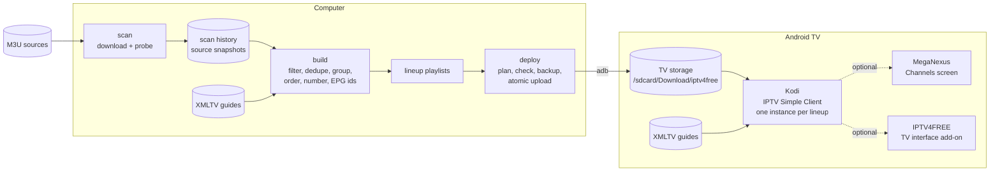

# IPTV4FREE

**Free IPTV automation for Android TV. Built around Kodi.**

[](https://github.com/searadacunha/IPTV4FREE/actions/workflows/tests.yml)


IPTV4FREE turns public M3U playlists into tested, organized channel lineups for Kodi on
Android TV, and keeps them up to date without destabilizing the TV.

It runs on a macOS or Linux computer on the same network as the TV. Once the playlists
are deployed, the TV works on its own: Kodi reads them from the TV's storage and downloads
programme guides itself. The computer is only needed to refresh the lineups.

## Contents

- [Overview](#overview)
- [Features](#features)
- [Architecture](#architecture)
- [Requirements](#requirements)
- [Quick start](#quick-start)
- [Configuration](#configuration)
- [How it works](#how-it-works)
- [Deployment](#deployment)
- [Channel management](#channel-management)
- [Performance](#performance)
- [Troubleshooting](#troubleshooting)
- [Limitations](#limitations)
- [Extending](#extending)
- [TV interface (Kodi add-on)](#tv-interface-kodi-add-on)
- [License](#license)

## Overview

Public IPTV playlists list thousands of streams, and many of them are offline at any given
time. IPTV4FREE:

1. downloads the playlists you configure and **tests every stream** the way Kodi will
   request it;
2. builds **lineups** (for example France, Portugal and World): working channels only,
   duplicates removed, names cleaned, favorites first, categories, stable channel numbers,
   programme guide (EPG) ids;
3. **deploys** them to the TV over ADB with safety checks, so that an update never forces
   Kodi to rebuild thousands of channels at once;
4. keeps **backups** and can **roll back**, and **diagnoses** the whole chain.

On the TV, each lineup is one instance of Kodi's IPTV Simple Client.

IPTV4FREE does not host or provide any stream. It works with the playlists you choose.

## Features

- **Stream validation.** Concurrent probes with per-request timeouts. HLS streams are
  followed from the master playlist to a variant and to the newest media segment; DASH
  manifests and direct streams are checked too. Probes send the same `User-Agent` and
  `Referer` headers Kodi will send.
- **Scan history.** A stream is removed only after several failed scans in a row (3 by
  default), so a flaky stream does not disappear and come back between updates.
- **Lineups.** Several sources per lineup; lineups are ordered by priority, and a stream
  listed in two lineups appears only in the first.
- **Cleaning and deduplication.** Names lose resolution and status tags
  (`TMC HD (1080p) [Geo-blocked]` becomes `TMC`). Duplicates of the same channel keep the
  highest resolution.
- **Favorites.** A per-lineup list of channel names, placed first, numbered first and
  grouped in a "Favorites" group.
- **Categories.** Large lineups can be split into a few groups (News, Sports, Movies &
  Series...) mapped from the source categories.
- **Stable numbering.** Channel numbers are written to the playlist (`tvg-chno`) and kept
  across rebuilds.
- **EPG mapping.** Each channel is matched to an XMLTV guide id by explicit alias, by
  `tvg-id`, or by display name.
- **Safe deployment.** Change plan computed exactly as Kodi will see it, change limit,
  shrink protection, dry run, validation before upload, atomic upload with checksum
  verification, automatic backup, rollback, and a Kodi restart policy that never interrupts
  playback by default.
- **Diagnostics.** `iptv4free doctor` checks the computer, the TV, Kodi, IPTV Simple Client
  and the deployed files, without changing anything.
- **Kodi installation.** `iptv4free setup --install-kodi` installs the official Kodi APK
  for the TV's CPU architecture after checking its published SHA-256.
- **MegaNexus interface (optional).** `iptv4free meganexus doctor | setup | rollback`
  checks the TV for the MegaNexus Kodi interface, backs up Kodi's settings, checks the
  official installer and restores Kodi if needed. MegaNexus' Channels screen shows the
  deployed lineups with no second import.
- **TV interface (Kodi add-on).** A full-screen IPTV4FREE home for Kodi with the official
  logo: groups by country and category, now and next, each channel's programme, favourites,
  search and a live preview, all with the remote. See
  [TV interface](#tv-interface-kodi-add-on).
- **No runtime dependencies.** Python 3.11+ standard library only, on the computer and in
  the Kodi add-on. Pillow is used only to build the add-on icon.

## Architecture



`update` runs `scan`, `build` and `deploy` in sequence. Each step reads only what the
previous one stored, so a failed step never leaves the TV half-updated.

## Requirements

| Requirement | Notes |
|---|---|
| Python 3.11 or newer | macOS or Linux. No third-party packages at runtime. |
| `adb` (Android SDK Platform-Tools) | `brew install android-platform-tools` on macOS, `apt install adb` on Debian/Ubuntu. |
| Android TV or Google TV | With developer options and ADB debugging enabled. Reference device: an Android 12 TV (32-bit ARM), see [Limitations](#limitations). |
| Kodi 21 | Installed by `iptv4free setup --install-kodi` or from the Play Store. |
| IPTV Simple Client | Kodi add-on, installed once from the official Kodi repository (see [Deployment](#deployment)). |
| MegaNexus (optional) | Kodi 21 or 22 on a 32-bit or 64-bit ARM TV; see [Deployment](#4-optional-meganexus-interface). |
| Network | The computer and the TV on the same local network. The computer needs Internet access to scan; the TV needs it to play. |

## Quick start

```bash
git clone https://github.com/searadacunha/IPTV4FREE.git
cd IPTV4FREE
python3 -m venv .venv && . .venv/bin/activate
pip install -e .

cp config/example.toml iptv4free.toml
# edit iptv4free.toml: set [tv] address to your TV, e.g. "192.168.1.50:5555"

iptv4free setup                          # checks the TV, prints the one-time Kodi steps
iptv4free scan                           # tests every stream (several minutes: 11,000+ streams)
iptv4free build                          # writes build/<lineup>.m3u
iptv4free deploy --dry-run               # shows what would change on the TV
iptv4free deploy --allow-large-update    # first deployment: imports all channels
iptv4free doctor                         # checks everything end to end
iptv4free meganexus setup                # optional MegaNexus interface, see Deployment
```

Later updates: `iptv4free update`. It refuses large changes unless you add
`--allow-large-update`.

## Configuration

The configuration is a TOML file: `./iptv4free.toml`, the path in `$IPTV4FREE_CONFIG`, or
`--config PATH`. `config/example.toml` documents every key. The main sections:

```toml
[tv]
address = "192.0.2.10:5555"              # ADB address (IPTV4FREE_TV overrides it)
remote_dir = "/sdcard/Download/iptv4free"

[scan]
timeout = 8           # seconds per HTTP request
workers = 32          # concurrent probes
max_failed_scans = 3  # consecutive failures before a stream is dropped

[safety]
max_changes = 500     # channel additions + removals allowed per deployment
min_keep_ratio = 0.5  # refuse a lineup that would lose more than half its channels
backups = 5
restart_kodi = "auto" # auto | always | never

[[lineup]]
id = "france"                            # file name on the TV: france.m3u
name = "France"                          # group prefix in Kodi
sources = ["https://iptv-org.github.io/iptv/countries/fr.m3u"]
epg = "https://xmltvfr.fr/xmltv/xmltv_tnt.xml.gz"
first_number = 1
favorites = ["TF1", "France 2", "M6"]
epg_aliases = { "TFX" = "NT1.fr" }

[[lineup]]
id = "world"
name = "World"
sources = ["https://iptv-org.github.io/iptv/index.m3u"]
first_number = 1000
by_category = true
exclude_categories = ["Shop"]
```

| Key | Meaning |
|---|---|
| `sources` | M3U URLs (`https://` or `file://`). Several sources are concatenated. |
| `epg` | XMLTV guide URL (`.xml` or `.xml.gz`), also entered in Kodi for this lineup. |
| `first_number` | First channel number of the lineup. Leave a gap between lineups. |
| `favorites` | Channel names, matched without case, accents or quality tags. |
| `epg_aliases` | Channel name to guide id, for channels whose names differ in the guide. |
| `by_category` | Group channels by category instead of one "All" group. |
| `exclude_categories` | Source categories to drop (for example teleshopping). |
| `[categories]` | Category groups and their order (defaults in `config.py`). |
| `[labels]` | Group labels ("Favorites", "All", "Other"), for other languages. |

Environment overrides: `IPTV4FREE_CONFIG`, `IPTV4FREE_TV`, `IPTV4FREE_ADB` (see `.env.example`).

## How it works

| Module | Role |
|---|---|
| `playlists.py` | M3U parser and writer; how IPTV Simple Client derives each channel's stream URL, headers and identity. |
| `scanner.py` | Concurrent stream probes (HLS, DASH, direct). |
| `pipeline.py` | `scan` (download, snapshot, probe, record) and `build` (one playlist per lineup). |
| `channels.py` | Name cleaning, deduplication, favorites, categories, ordering, numbering, validation. |
| `epg.py` | XMLTV channel list download, cache and matching. |
| `updates.py` | Scan history, stable channel numbers, changesets, atomic file writes. |
| `deploy.py` | Deployment plan, safety checks, backups, atomic upload, rollback. |
| `adb.py` | `adb` wrapper with a timeout on every call. |
| `kodi.py` | Kodi JSON-RPC client, restart policy, official APK installation, setup instructions. |
| `doctor.py` | Read-only diagnostics. |
| `cli.py` | Command line interface. |

Key points:

- **Parsing.** `#EXTINF` lines are tokenized attribute by attribute, so quoted values may
  contain commas and spaces. Malformed entries (missing URL, broken quotes, URL without
  `#EXTINF`) are skipped and reported, never fatal.
- **Channel identity.** IPTV Simple Client identifies a channel by its name plus its
  effective stream URL: the URL with the `User-Agent` and `Referer` options appended after a
  `|`. It takes `#EXTVLCOPT` values up to the first space and `#KODIPROP` values whole.
  IPTV4FREE computes the same identity, so the deployment plan counts exactly the channels
  Kodi will delete and insert. A renamed channel counts as one removal and one addition.
- **Deterministic output.** The build depends only on the set of input entries, not on
  their order: duplicates keep the highest resolution (ties: smallest URL), and channels are
  sorted by favorite rank, category, name and URL. Rebuilding with unchanged inputs produces
  identical bytes, and `deploy` then reports "TV already up to date".
- **Numbering.** Favorites take `first_number`, `first_number + 1`... in the configured
  order; other channels receive the next free number once and keep it (stored in
  `channel-numbers.json`).
- **Deployment sequence.** Connect; pull the playlists currently on the TV; compute the
  plan; validate the new files; refuse if the plan exceeds `max_changes` or shrinks a lineup
  below `min_keep_ratio`; back up the TV's files; upload each file as `<id>.m3u.uploading`;
  compare its SHA-256 on the TV; rename it over the old file; apply the restart policy.

State is kept in `~/.local/state/iptv4free/`: source snapshots, `scan-history.json`,
`channel-numbers.json`, EPG cache, backups, downloaded APKs and `iptv4free.log`.

## Deployment

### 1. Enable ADB on the TV

Menu names vary by manufacturer. On most Google TV / Android TV models:

1. Settings > System > About: select "Android TV OS build" seven times to enable developer
   options.
2. Settings > System > Developer options: enable USB debugging (and network debugging if
   your TV has a separate option).
3. Find the TV's IP address (Settings > Network) and run `adb connect <tv-ip>:5555`.
   Accept the authorization prompt on the TV, ideally with "Always allow".

### 2. Kodi and IPTV Simple Client

```bash
iptv4free setup --install-kodi   # skip --install-kodi if Kodi is already installed
```

`setup` reports the TV's Android version and CPU architecture, installs the official Kodi
APK if asked, and prints the one-time Kodi steps with the exact values for your lineups:

1. Open Kodi once; if it asks for storage access, allow it (it reads the playlists from shared storage).
2. Add-ons > Install from repository > Kodi Add-on repository > PVR clients >
   IPTV Simple Client > Install.
3. Add-ons > My add-ons > PVR clients > IPTV Simple Client > Configure: edit the existing
   configuration for the first lineup, then "Add add-on configuration" for each other one.
   For each: Name, General > Location: "Remote path (Internet address)", General > M3U
   playlist URL: the path printed by `setup` (for example
   `/storage/emulated/0/Download/iptv4free/france.m3u`), EPG > XMLTV URL.

Kodi stores add-on settings in app-private storage that ADB cannot write, which is why this
step is done once with the remote. The playlists themselves live in shared storage and are
updated by IPTV4FREE.

### 3. Deploy

```bash
iptv4free build
iptv4free deploy --dry-run
iptv4free deploy --allow-large-update   # the first import exceeds max_changes
```

After an upload, `restart_kodi = "auto"` restarts Kodi only if it is running and nothing
is playing; otherwise the new playlists load at Kodi's next start. `--restart always`
restarts it even during playback, `--restart never` leaves it alone.

To undo the last deployment: `iptv4free rollback` (`--list` shows the backups).

### 4. Optional: MegaNexus interface

[MegaNexus](https://github.com/MegaNexusMediaPlayer/MegaNexus) is a third-party Kodi
interface (skin, home screen, Channels, YouTube and Music apps) for Kodi 21 and 22. It is
not part of IPTV4FREE and is never redistributed by it (its license forbids that): Kodi
installs it from the official MegaNexus repository.

Its **Channels** screen reads Kodi's own TV channels, so the lineups IPTV4FREE deploys to
IPTV Simple Client appear there with their numbers and guide, without importing them a
second time. Leave the Channels screen's own "IPTV setup" empty: adding the same playlists
there would load the channels a second time. `iptv4free deploy` stays the only update path,
so there is no separate sync command.

```bash
iptv4free meganexus doctor     # read-only: CPU build, RAM, Kodi, add-ons, skin, channels
iptv4free meganexus setup      # backs up Kodi's settings, checks the official zip, prints the steps
iptv4free meganexus rollback   # restores Kodi's settings and turns MegaNexus off
```

`setup` saves Kodi's settings (everything in `userdata` but the thumbnail cache) and the
deployed playlists to `~/.local/state/iptv4free/meganexus/backups/`, and checks that the
repository zip Kodi will download matches the SHA-256 GitHub publishes for the latest
release. The installation itself is done with the remote, following the printed steps.

`rollback` refuses while Kodi is playing. It quits Kodi, writes back every settings file
that changed since the backup (ADB may replace files in Kodi's folder, not create them),
starts Kodi and disables the MegaNexus add-ons. If Kodi is frozen, `--force` stops it
first. Files Kodi created after the backup, such as the MegaNexus entry in `sources.xml`,
stay.

## Channel management

The example configuration defines three lineups:

| Lineup | Sources | Groups in Kodi | Numbers |
|---|---|---|---|
| France | iptv-org French channels | France · Favorites, France · All | from 1 |
| Portugal | iptv-org Portuguese channels | Portugal · Favorites, Portugal · All | from 500 |
| World | iptv-org full index | World · News, World · Sports, World · Movies & Series, ... | from 1000 |

French and Portuguese channels take priority because their lineups come first: a stream
present in the World index is kept in France or Portugal and not repeated in World.

Favorites are channel names. A favorite that no working stream matches is reported by
`build` ("favorites not found") and keeps its number free.

Kodi displays the numbers written by IPTV4FREE when Settings > PVR & Live TV > Channels >
"Use channel numbers from backend" is enabled. With several lineups, also enable the expert
setting "Allow backend channel numbers with more than one PVR add-on". Otherwise Kodi
numbers channels itself, in list order.

To list a lineup's channels first, set its IPTV Simple Client instance to the highest value
in Settings > PVR & Live TV > General > "Client priorities".

## Performance

Local benchmark, reproducible with `python scripts/benchmark.py 10000` (synthetic playlist,
no network). Apple M3, Python 3.11.15:

| Step | 10,000 channels |
|---|---|
| Parse M3U | 33 ms |
| Build lineup (dedupe, group, order, number) | 60 ms |
| Render M3U | 15 ms |
| Changeset (1 % renamed) | 9 ms |

Scanning is network-bound. One measured run of the example configuration (November 2026,
home connection, `workers = 64`, `timeout = 8`):

| Step | Result |
|---|---|
| `scan` | 11,404 unique streams probed in 5 min 26 s; 7,922 answered |
| `build` (EPG lists cached) | 7,796 channels in three lineups in about 1 s |

These figures describe one run, not a guarantee: duration depends on your connection and on
how many streams time out, and the number of working streams changes daily.

On the TV, the cost that matters is Kodi's channel database. On the Android 12 test TV
(1.8 GB RAM), a first import of about 7,900 channels into an empty database completed in
about 20 seconds, while replacing all of them in a single update made the TV unresponsive
for more than an hour. The default `max_changes = 500` is a conservative limit, not a
measured threshold.

## Troubleshooting

| Symptom | What to do |
|---|---|
| `TV ... is not ready (state: unreachable)` | Check that the TV is on and on the same network, run `adb connect <address>`, accept the prompt on the TV. |
| `state: unauthorized` | Accept the ADB authorization prompt on the TV. |
| `adb timed out` | The TV is busy (often Kodi updating its database). Wait and retry. If it stays unresponsive, restart the TV. |
| `deploy` says `REFUSED ... exceed safety.max_changes` | Many channels changed (a renamed source, a new lineup). Check with `--dry-run`, then use `--allow-large-update` when nobody is watching. |
| `REFUSED ... min_keep_ratio` | The new build lost most of a lineup's channels, usually a scan during a network outage. Run `scan` again. |
| `no snapshot ... run iptv4free scan first` | Run `iptv4free scan`. |
| No programme guide | Check the lineup's `epg` URL in Kodi (EPG > XMLTV URL). `build` prints how many channels have a guide id; add `epg_aliases` for names that differ. |
| A channel does not play | Streams go offline, are geo-blocked, or need headers. The next scans remove dead streams. For HLS streams with separate audio or subtitle tracks, try IPTV Simple Client > Advanced > "Use inputstream.adaptive for m3u8 (HLS) streams". |
| Headers with spaces | IPTV Simple Client cuts `#EXTVLCOPT` values at the first space. Use `#KODIPROP:http-user-agent=...` in your own playlists to send a full value. |
| Kodi shows no channels | Run `iptv4free doctor`: it checks the storage permission, the files on the TV and IPTV Simple Client. |
| The TV froze after an update | Restart the TV. Use `deploy --dry-run` before large updates and keep `max_changes` low. `iptv4free rollback` restores the previous playlists. |
| MegaNexus: "Unknown sources" stays off | Kodi ignores this setting when it comes through JSON-RPC: switch it on in Settings > System > Add-ons and answer Yes. |
| MegaNexus: the zip copied to the TV is not listed | Android 11 and later hide other apps' non-media files from Kodi. Install from the official source URL (`meganexus setup` prints the steps). |
| MegaNexus: Kodi went back to its old skin | The "Keep this skin?" question expires after about 10 seconds. Open MegaNexus again and answer Yes. |
| MegaNexus: Kodi is frozen | `iptv4free meganexus rollback --force` (refused while something plays). |
| TV interface: Kodi crashes or cannot read the ZIP during "Install from zip file" | Serve the ZIP with `python3 scripts/serve_addon.py`, not `python3 -m http.server`: Kodi reads ZIP files with byte ranges, which that server ignores. |
| TV interface: "Kodi PVR indisponible" or no channels | IPTV Simple Client is off or still loading: enable it, wait for the channels to appear in Kodi, then choose EN DIRECT. |
| TV interface: a channel shows "Lecture impossible" | The stream did not open (offline or geo-blocked). Kodi's log says why; the next scans remove dead streams. |

Logs: `~/.local/state/iptv4free/iptv4free.log`; `-v` prints debug output.

## Limitations

- MegaNexus was tested on one TV (Android 12, 32-bit ARM, 1.8 GB of RAM, Kodi 21.3,
  MegaNexus 9.1.0, 7,883 channels). Verified there: installation from the official source,
  the HUB, Home with posters and descriptions, Search, the YouTube app (playback) and the
  Music app (opens), remote navigation (0.4 to 1.2 s per key), the Channels screen with all
  7,883 channels, the IPTV4FREE groups and the guide, playback of channels from France,
  Portugal and World groups from it, `meganexus doctor`, `setup`, `rollback --force`, and
  Kodi restarts (cold start, forced stop, IPTV4FREE's restart) opening on the HUB. Inside a
  group, Channels numbers channels by position; "All channels" shows the lineup numbers.
- Problems seen on that TV: Kodi froze twice at startup on MegaNexus' "Who's watching?"
  screen, after a crash and after a forced stop (cause unknown); three later starts
  worked, the last two with that screen switched off. Kodi once stayed stuck after
  "Unloaded skin" when quitting (IPTV4FREE's restart stops it after 20 s; settings were
  already saved). Kodi crashed once in `inputstream.adaptive` while switching from an HLS
  channel. The TV left the Wi-Fi for 8 minutes once while MegaNexus was running (cause
  unknown).
- The TV interface add-on 0.3.0 was tested on the same TV under MegaNexus with its 7,883
  channels (opening in under 2 s, 32 to 72 ms per key, paging, groups, favourites, search,
  playback, return and channel switching) and in Kodi 21.3 on macOS. How long a channel
  takes to start depends on its stream (1.6 s to 30 s seen), not on the add-on. Long-press
  OK on the TV remote was not tried.
- Kodi's add-on configuration (installing IPTV Simple Client, one instance per lineup) is a
  one-time manual step: Kodi keeps it in app-private storage that ADB cannot write.
- Verified on one TV model (Android 12, 32-bit ARM, Kodi 21.3, IPTV Simple Client 21.11.0):
  the Kodi configuration, playback from playlists in shared storage using the same M3U
  layout (one IPTV Simple Client instance per lineup, without the `tvg-chno` attribute), and
  IPTV4FREE's read-only commands (`setup`, `doctor`, `deploy --dry-run`). The upload, backup
  and rollback paths are covered by the test suite against a simulated ADB device.
- On Android 13 and later, whether Kodi can read playlists from shared storage with the
  standard permission has not been verified.
- A scan says whether a stream answered from the computer's network at scan time. It
  assumes the TV has the same public IP address (same home network); geo-blocked streams
  may behave differently elsewhere.
- Kodi shows the generated channel numbers only with the backend numbering settings
  described above.
- EPG coverage depends on the guide provider; channels without a match have no guide.
- Public playlists change daily. Streams listed by third parties can disappear or move at
  any time.

## Extending

- **Another country or language**: add a `[[lineup]]` with its sources (iptv-org publishes
  per-country and per-language playlists), an XMLTV guide, favorites and a free
  `first_number` range. Translate group labels in `[labels]` and `[categories]`.
- **Your own playlists**: any `https://` or `file://` M3U works as a source.
- **Code**: start from `pipeline.run_build` (output) or `deploy.apply` (deployment). Run
  `pytest` before submitting changes; see [CONTRIBUTING.md](CONTRIBUTING.md).

## TV interface (Kodi add-on)

`kodi-addon/script.iptv4free/` is IPTV4FREE's own full-screen interface for Kodi, with the
official IPTV4FREE logo, in electric blue, white and black. It reads the channels Kodi already
has from IPTV Simple Client: groups by country and category, channel logos, now and next with
progress, each channel's full programme, Kodi's TV guide, favourites, search, and a live
preview of the channel playing. Channel logos come from the playlists' `tvg-logo`. Everything works with the remote; Back from the video returns
to IPTV4FREE. It changes nothing in Kodi, IPTV Simple Client or MegaNexus.


*Real Kodi 21.3 screen on a Mac, with a test playlist of fictional channels.*

**Download:** [script.iptv4free-0.3.1.zip](https://github.com/searadacunha/IPTV4FREE/raw/refs/heads/feat/iptv4free-tv-ui/dist/script.iptv4free-0.3.1.zip)
(`python3 scripts/build_addon.py` rebuilds the same file, byte for byte).

Install on the TV:

1. Put the ZIP in `dist/` (it is already there in a clone) and run `python3 scripts/serve_addon.py`.
   It prints the address to use, such as `http://192.168.1.30:8780/`. Do not use
   `python3 -m http.server`: Kodi reads ZIP files with byte ranges, which that server ignores,
   and Kodi 21.3 crashes while installing.
2. In Kodi: **Settings → File manager → Add source**, enter that address, name it `IPTV4FREE`.
3. **Settings → System → Add-ons → Unknown sources**: on.
4. **Add-ons → Install from zip file → IPTV4FREE → script.iptv4free-0.3.1.zip**, then stop the
   server (Ctrl+C).
5. Open **Add-ons → Program add-ons → IPTV4FREE**.

To remove it: **My add-ons → Program add-ons → IPTV4FREE → Uninstall**. Playlists and settings
stay as they are.

Remote keys, low-RAM design, the logo files, the study of a full `skin.iptv4free` theme and
what was and was not tested: [docs/IPTV4FREE-TV-UI.md](docs/IPTV4FREE-TV-UI.md). Tested on the
TV (Kodi 21.3, MegaNexus, 7,883 channels) and in Kodi 21.3 on a Mac.

## License

IPTV4FREE is released under the [MIT License](LICENSE). Kodi, its add-ons and the Android
platform tools are separate projects under their own licenses; they are not distributed with
IPTV4FREE. See [THIRD_PARTY_NOTICES.md](THIRD_PARTY_NOTICES.md).

## IPTV4FREE button on Android TV (optional)

An independent Android TV launcher named **IPTV4FREE** adds a branded home-screen tile. Pressing it opens official Kodi and then starts the installed `script.iptv4free` Kodi interface through localhost JSON-RPC. Kodi, PVR IPTV Simple and MegaNexus remain installed and unchanged.

Sources: `android-tv-launcher/`. The APK is compiled on GitHub Actions and published as `dist/IPTV4FREE-AndroidTV-Launcher-0.1.2.apk` when the build passes. See the [Android TV launcher install and security guide](docs/IPTV4FREE-ANDROID-TV-LAUNCHER.md). Remove the Kodi **shortcut** from the home favorites manually, not the Kodi application package.

Tested on the TCL on 8 Nov 2026 with add-on 0.3.1: cold start, Kodi already open, Back and Quit to the TV home (playback stops), and the error screen. On a cold start Kodi's own home shows for about 1.5 s before IPTV4FREE. From 0.1.2 GitHub signs the APK with a fixed IPTV4FREE key (repository secrets, certificate SHA-256 `b44870f8…6b78`), so updates install over the previous version; moving from 0.1.0 or 0.1.1 needs one last uninstall of the launcher (never Kodi).
