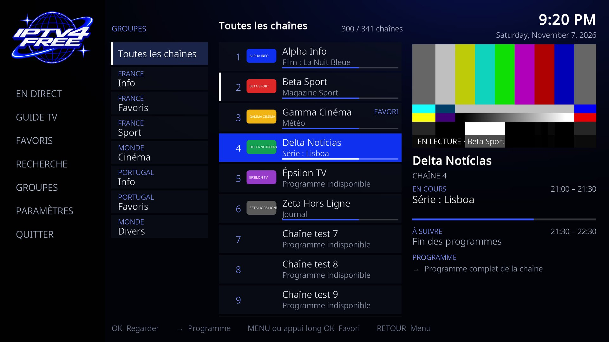
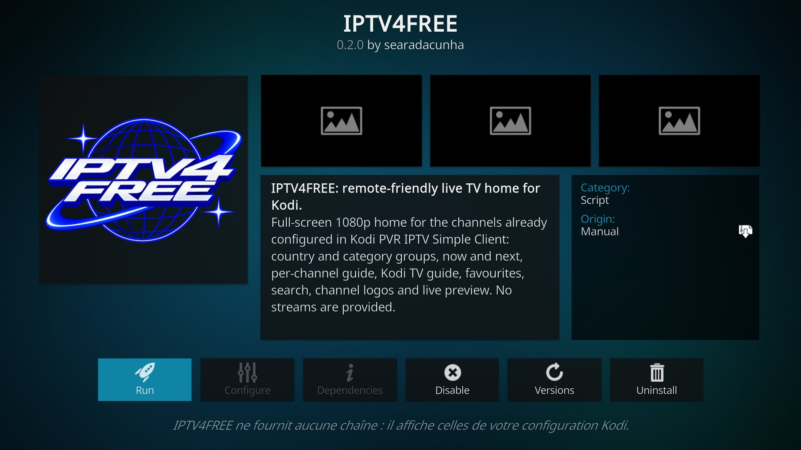

# IPTV4FREE — interface TV pour Kodi (module 0.2.0)

Interface plein écran 1920 × 1080 (16:9), pilotée à la télécommande, pour les chaînes déjà configurées dans **Kodi PVR IPTV Simple Client**. Elle porte le logo officiel IPTV4FREE et les couleurs bleu électrique, blanc et noir. Elle ne fournit aucune chaîne ni aucun flux, et ne modifie ni Kodi, ni IPTV Simple, ni MegaNexus.



*Capture réelle de Kodi 21.3 (Omega) sur Mac, avec une playlist de test aux chaînes fictives : la chaîne en cours de lecture apparaît en direct dans le panneau de droite.*

## Ce que fait l'interface

| Zone | Contenu |
|---|---|
| Colonne de gauche | Logo officiel, puis EN DIRECT, GUIDE TV, FAVORIS, RECHERCHE, GROUPES, PARAMÈTRES, QUITTER |
| Groupes | Les groupes réels d'IPTV Simple, affichés par pays et catégorie (`France · Info` devient FRANCE / Info) ; « Toutes les chaînes » en tête |
| Chaînes | Numéro, logo, nom, programme en cours, barre de progression, repère FAVORI, repère blanc sur la chaîne en lecture |
| Panneau de droite | Aperçu vidéo de la chaîne en lecture (ou logo de la chaîne), programme en cours avec horaires et progression, programme suivant, programme complet de la chaîne |

**Télécommande**

| Touche | Effet |
|---|---|
| Flèches | Se déplacer ; ← et → passent d'une colonne à l'autre |
| OK sur une chaîne | Regarder (plein écran). OK sur la chaîne déjà en lecture : retour au plein écran, sans relancer le flux |
| → sur une chaîne | Programme complet de la chaîne ; OK sur une émission affiche son résumé |
| MENU ou appui long sur OK | Regarder, ajouter ou retirer des favoris, programme de la chaîne |
| RETOUR | Du programme vers les chaînes, des chaînes vers le menu, du menu vers Kodi |
| RETOUR pendant la vidéo | Revient dans IPTV4FREE, la chaîne continue dans l'aperçu |

GUIDE TV ouvre la grille complète de Kodi (tous les programmes, toutes les chaînes) ; RETOUR revient dans IPTV4FREE, sur le même bouton. PARAMÈTRES ouvre les réglages TV de Kodi.

**Pour une TV à 2 Go de RAM** : chaînes chargées par pages de 300 (la suite se charge en arrivant en bas de la liste), appels JSON-RPC de 100 chaînes, programme complet chargé seulement à la demande, logos des chaînes chargés en arrière-plan, recherche et favoris limités à 60 résultats. Mesuré sur Mac : ouvrir l'interface avec 341 chaînes ajoute environ 4 Mo à Kodi.

**Favoris** : enregistrés par nom de chaîne dans `userdata/addon_data/script.iptv4free/favorites.json`. Ils survivent à une mise à jour des playlists, qui change les identifiants internes de Kodi (vérifié).

**Une seule copie** : si IPTV4FREE est resté ouvert derrière l'accueil de Kodi (touche HOME), le relancer ramène la fenêtre existante au lieu d'en ouvrir une deuxième.

## Installer sur la télévision

Prérequis : les chaînes sont déjà visibles dans Kodi (IPTV Simple Client). Sur l'ordinateur : `iptv4free doctor`.

1. Le ZIP est dans `dist/` du dépôt (branche `feat/iptv4free-tv-ui`), lien direct : [script.iptv4free-0.2.0.zip](https://github.com/searadacunha/IPTV4FREE/raw/refs/heads/feat/iptv4free-tv-ui/dist/script.iptv4free-0.2.0.zip). Depuis un clone, il est déjà en place ; un fichier téléchargé à part se range dans `dist/`. On peut aussi le reconstruire : `python3 scripts/build_addon.py` donne le même fichier, octet pour octet.
2. Le servir sur le Wi-Fi : `python3 scripts/serve_addon.py`. Le script affiche l'adresse à saisir dans Kodi, par exemple `http://192.168.1.30:8780/`.
   - **Ne pas utiliser `python3 -m http.server`** : Kodi lit les ZIP par plages d'octets (*ranges*), que ce serveur ignore. Kodi 21.3 n'arrive alors pas à lire le ZIP et **plante** pendant l'installation (constaté le 07/11/2026). `serve_addon.py` répond à ces plages.
3. Dans Kodi : **Paramètres → Gestionnaire de fichiers → Ajouter une source**, saisir l'adresse affichée, nommer la source `IPTV4FREE`.
4. **Paramètres → Système → Extensions → Sources inconnues** : activer, si ce n'est pas déjà fait.
5. **Extensions → Installer depuis un fichier ZIP → IPTV4FREE → script.iptv4free-0.2.0.zip**, puis arrêter `serve_addon.py` (Ctrl+C).
6. Ouvrir **Extensions → Extensions de programmes → IPTV4FREE**. Le module apparaît aussi dans les extensions vidéo.

**Désinstaller** : Extensions → Mes extensions → Extensions de programmes → IPTV4FREE → Désinstaller. Les playlists, IPTV Simple, MegaNexus et les réglages de Kodi ne sont pas touchés.

## Logo officiel

`assets/branding/IPTV4FREE-original.png` est le PNG fourni par Benjamin, conservé tel quel (1536 × 1024, RGBA, SHA-256 `895a691c86d56185416257ce026c540e49b49aaedf438c98c5242dcee60485bf`). `scripts/prepare_branding.py` en produit :

- `resources/skins/Default/media/iptv4free-logo.png` : copie octet pour octet, affichée dans la colonne de gauche et pendant le chargement ;
- `icon.png` : carré transparent 512 × 512 déclaré dans `addon.xml`. Seules les marges invisibles du PNG (alpha ≤ 1/255) sont retirées, puis le logo est réduit proportionnellement et centré, sans recoloration ni découpe de pixels visibles.



Après remplacement du logo : `python3 -m pip install pillow`, `python3 scripts/prepare_branding.py`, puis `python3 scripts/build_addon.py`. Pillow ne sert qu'à la construction ; Kodi n'en a pas besoin.

## Thème Kodi complet (`skin.iptv4free`) : étude

Un thème Kodi remplace **toutes** les fenêtres de Kodi : accueil, réglages, lecteur et OSD, guide, enregistrements, clavier, dialogues. Estuary en compte plus de 150 fichiers XML, et une fenêtre absente du thème devient inutilisable. Les options :

- **partir d'Estuary** (GPL-2.0, Team Kodi) et le renommer : faisable, mais le thème passe sous GPL-2.0 et doit suivre chaque version de Kodi ;
- **sur la TV**, activer un thème remplace MegaNexus, qui est lui-même un thème (`skin.meganexus`) : l'accueil MegaNexus disparaîtrait. Les changements de thème ont déjà provoqué des gels au démarrage sur cette TV (journal du 06/11).

Décision pour 0.2.0 : rester un **module de programmes** autonome. Il fonctionne sous n'importe quel thème, ne touche ni à Kodi ni à MegaNexus, et s'affiche en plein écran avec sa propre identité. Un thème complet reste possible plus tard, sur une TV de test et avec l'accord de Benjamin.

Conséquence technique : Kodi n'utilise que les polices du thème actif. Le module emploie les noms de polices d'Estuary (`font12`, `font13`, `font30_title`…). Sous un autre thème, Kodi se rabat sur `font13` si un nom manque. Le rendu sous MegaNexus n'a pas été vérifié (sa licence interdit de lire son code).

## Inspecter la TV avec REA et ADB (facultatif, lecture seule)

[REA](https://github.com/morluto/rea) est un outil d'inspection Android et de rétro-ingénierie, pas un thème Kodi. Sur **votre** TV, avec ADB autorisé :

```sh
rea inspect-adb-client
rea list-adb-devices
rea inspect-adb-device SERIAL_TV
rea inspect-adb-display SERIAL_TV
rea inspect-adb-package SERIAL_TV org.xbmc.kodi
rea capture-adb-screen SERIAL_TV --output-directory ./captures-avant
```

`screencap` ne capture pas la couche vidéo de la TV : pour prouver qu'une chaîne joue, lire `Player.Time` par JSON-RPC ou le journal MediaCodec (`logcat`). Ne pas extraire, adapter ni redistribuer le code ou les images de MegaNexus.

## Architecture

- `kodi-addon/script.iptv4free/` : module `xbmc.python.script`.
  - `default.py` : fenêtre `WindowXML` plein écran. Comme c'est une vraie fenêtre Kodi, RETOUR depuis la vidéo ou le guide revient dedans.
  - `resources/lib/core.py` : appels JSON-RPC locaux (`PVR.GetChannelGroups`, `PVR.GetChannels`, `PVR.GetChannelDetails`, `PVR.GetBroadcasts`, `Player.Open`), sans dépendance à Kodi, donc testables.
  - `resources/skins/Default/1080i/IPTV4FREE.xml` : l'écran.
- `scripts/prepare_branding.py`, `scripts/build_addon.py` (ZIP reproductible), `scripts/serve_addon.py` (serveur Wi-Fi avec plages d'octets).
- `tests/test_tv_ui.py` : données PVR synthétiques, `default.py` exécuté contre des faux modules Kodi, logo, icône, XML, ZIP, serveur.

## Ce qui a été vérifié, et ce qui ne l'a pas été

Vérifié le 07/11/2026 dans **Kodi 21.3 sur Mac**, avec PVR IPTV Simple Client 21.11.0, 341 chaînes de test, un guide XMLTV et des flux HLS locaux :

- installation par « Installer depuis un fichier ZIP », depuis une source locale puis par le réseau avec `serve_addon.py` ;
- icône dans la fiche de l'extension, logo à l'écran ;
- navigation et focus à la télécommande, groupes, programme de la chaîne et résumé, favoris (menu contextuel, vue Favoris, survie à une réimportation), recherche avec accents ;
- chargement par pages (300 puis 341) ;
- lecture, RETOUR avec aperçu, passage d'une chaîne à l'autre, chaîne en panne (« Lecture impossible ») ;
- GUIDE TV et PARAMÈTRES avec retour au même bouton, état sans PVR, une seule copie.

**Pas vérifié sur la télévision** (TCL, Android 12, armeabi-v7a, 1,8 Go) : elle était éteinte et injoignable pendant le développement. Restent donc à essayer sur la TV :
- le rendu sous le thème MegaNexus ;
- la fluidité avec 7 883 chaînes ;
- l'appui long sur OK de la télécommande TCL ;
- l'aperçu vidéo avec le décodeur MediaCodec ;
- l'écran de chargement avec le logo, trop bref pour être capturé sur Mac.
